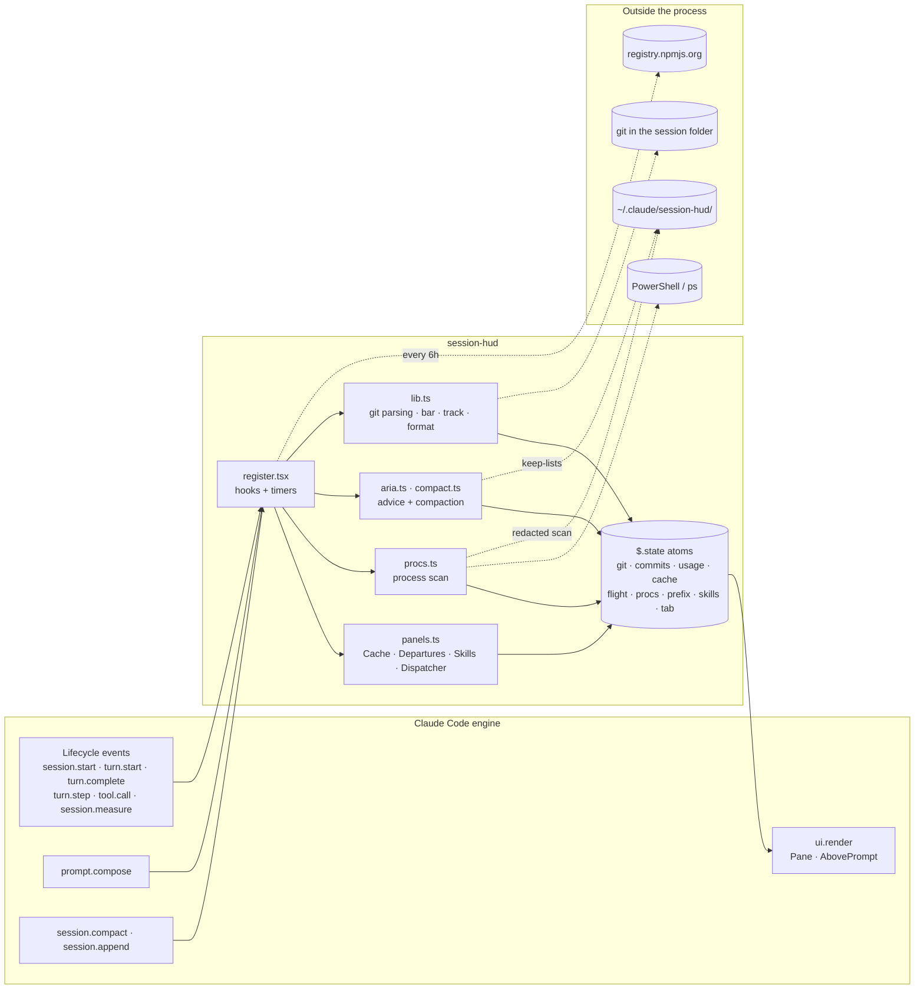
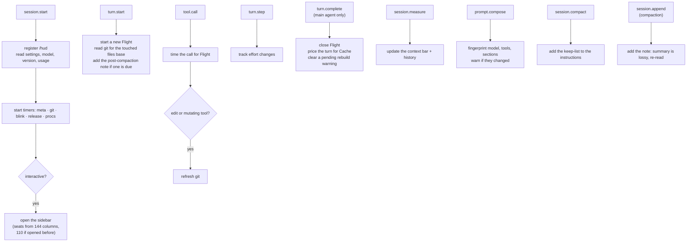
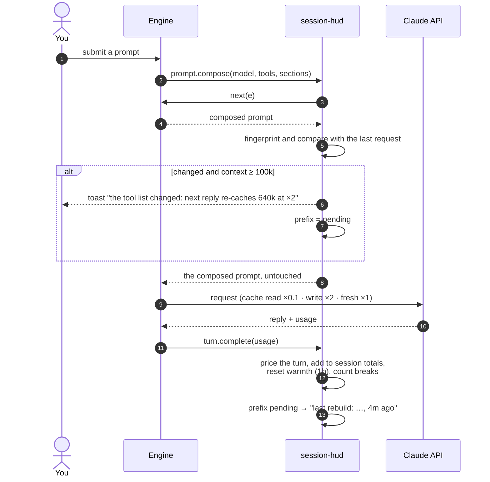
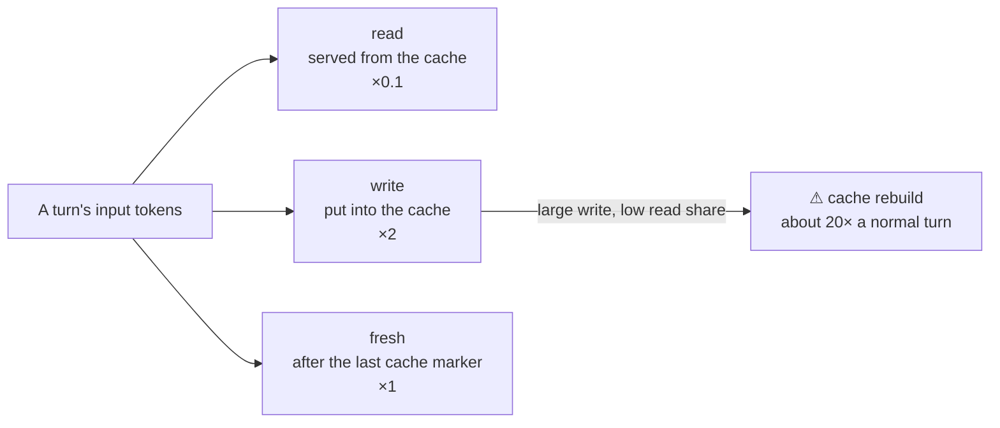
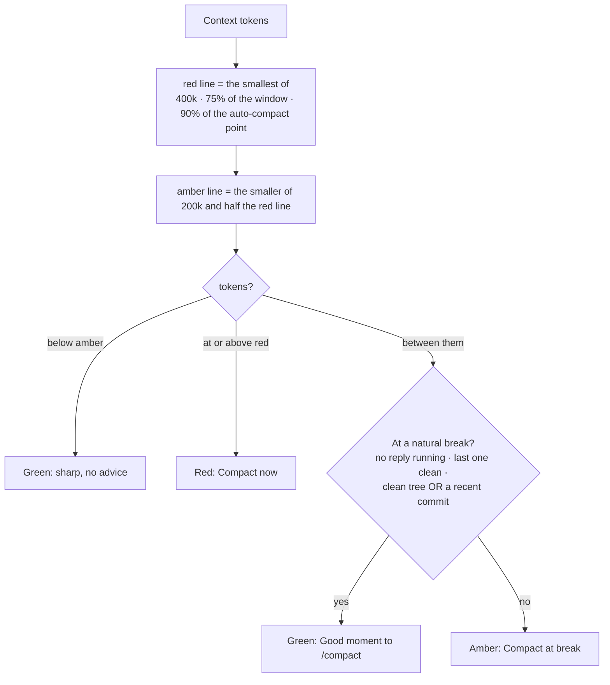
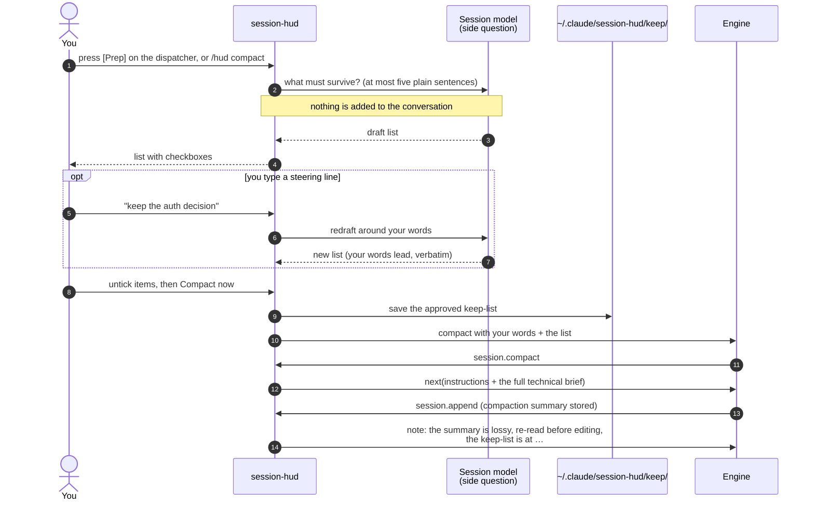
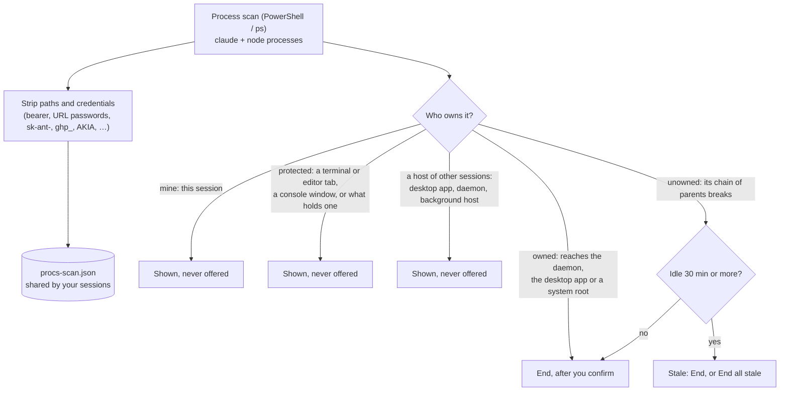

# session-hud

A sidebar for Claude Code sessions, drawn as a transit line: workspace, Claude and its
rate limits, the session, git and the context, with a one-line digest above the prompt.

```
/plugin install session-hud --marketplace 0xRabbidfly/claude-hud-mod
```

It opens by itself in fullscreen sessions (it seats from 144 terminal columns, or 110 once
you have opened it yourself) and on demand with `/hud`. The tabs, pressed by number when
the sidebar holds the keys:

1. **Hub**, the session as a metro line in amber:

   ```
   ━━━━━━━━━━━━━━━━━━━━━━━━━━━━━━━━━━━━━━━━
   ▸ ❄ cold in 12m · re-cache 312k     +1
   ━━━━━━━━━━━━━━━━━━━━━━━━━━━━━━━━━━━━━━━━

    ◉━ claude-plugins
    ┃  ~/Projects/
    ○━ CLAUDE 2.1.296 → 2.1.300 out
    ┃  claude-opus-5-5 · high
    ┃  5h ▰▰▰▰▱▱▱▱▱▱  42%  ↻ 2h 05m
    ○━ Rework the Cache tab
    ┃  7c1f3a9e-2b4d-4e6f-8a0b-5d3c9e1f7a2b
    ┃  ● Start remote control
    ┃  2h 14m · 48 prompts · $12.43
    ┣━━━━━━━╮
    ┃       ○ main → origin/main ↑1
    ┃       ┃ ~3 +1 -0 · +120 -14
    ┣━━━━━━━╯
    ┃ CONTEXT                    COMPACT
    ┃      240k/1M · 24% ▼
    ╰━━━━━━━━┯━━━━━━━━┯━━◆┄┄┄┄┄┄┬┄┄┄┄┄┄◎
     0     100k     200k     300k   387k
                             ≈2      ≈4

    ▐█▓▒░▁▁▌━▐▁▁▁▁▁▁▌━▐▁▁▁▁▁▁▌━▐█▄▙▖
     ○    ○   ○    ○   ○    ○   ○ ○
    ▔▔▔▔▔▔▔▔▔▔▔▔▔▔▔▔▔▔▔▔▔▔▔▔▔▔▔▔▔▔▔▔▔▔▔
    ▄▀▀▄           █150k ▓40k ▒30k ░20k
    █  █
    ▀▄▄▀  ARIA · Cruising
          5h pace steady

      ╭───────────────────────────────╮
      │ ◆ session-hud 1.1.6 · transit │
      ╰───────────────────────────────╯
   ```

   - **The dispatcher**, the band at the top: the one thing most worth your attention now,
     with a button that acts on it. In order: the 5-hour window running out within the hour
     (red), compaction overdue, the prompt cache in its last 15 minutes (and
     what a cold one re-caches, in tokens), compaction advised, the window running out later,
     300 or more lines (or 15 files) uncommitted, stale processes, and a newer Claude Code.
     **[Prep]** opens Prep compact, **[Procs]** the Procs tab and **[Read]** what's new; `+N`
     says how many more are waiting, and pressing it steps to the next. With none of them,
     `✓ All clear`, with the cache's time left. On the Hub the band owns the cache, so the
     digest above it leaves the cache out.
   - **The origin** `◉` is the working dir's own name, with the folders above it on the track (the
     home folder as `~`; a path too long for the row loses its start).
   - **CLAUDE** carries its version, and after it in red what is out when a newer release
     is. Click either version for **what's new** (see [What's new](#whats-new)). Then the model
     and the effort level, each a button: click one to put `/model` or `/effort` in the
     prompt box and pick another. Under the pointer the level shows its rank's colour (`low`
     grey, `medium` blue, `high` green, `xhigh` amber, `max` orange, `ultra` a colour a
     letter); a button has no colour at rest. Then each rate
     limit on a row of its own: a meter, its share and when it resets.
   - **The session's station** is its title: click it to put `/rename ` in the prompt box and
     type a new name (a draft you have typed is kept, and you are asked to clear it first).
     Under it, its whole id: click it to copy it for `claude --resume`. A green **Remote
     Control** light while `/rc` is on; while it is off, a red one and **Start remote
     control**, which puts `/rc <session name>-RC` in the prompt box for you to change the
     name and send (a draft you have typed is kept). Then age, prompt count and cost.
   - **Git** is a loop off the line: the branch, its upstream and how far apart, the changed
     files and lines.
   - **CONTEXT** curls off the line under git and runs across the sidebar, from 0 at the
     corner to the **COMPACT** terminus `◎` at the right edge: where this session compacts
     (see [Compaction](#compaction)), red once you are past it.
   - **YOU ARE HERE** is the marker `◆`, sliding right along that track as the context
     fills, with `▼` and its reading above it, bold in the colour of the zone it stands in (past the middle of the track it reads
     leftward, ending in `▼`, over the way travelled and clear of the terminus). The track is
     solid behind it and dotted ahead, in zones: green its first 60%, amber the next 30%, red
     the last 10%. The marker's zone is the context's one colour: the train's cargo and the
     legend take it too. Stops are ticked on it in tokens: every 100k on a line to 387k, a
     round step apart and six at most (every 200k to 900k, every 50k on a small window), the
     tokens under each tick (dim once passed) and, once there is a forecast, how many turns
     off each stop ahead is. A stop label that would touch another is left out; the 0 and
     the terminus always show.
   - **The context train and ARIA**, the conductor (a head alone, so she fits in five rows),
     sit under the curl in a fixed place, so nothing on the Hub moves as the context fills.
     The train's legend sits flush right beside her head, each category's pattern and its
     tokens (with three-letter names where the row has room). Under it, her name and mood on
     one row (`Napping`, `Cruising`, `Watch the pace`, `Time to /compact`), then the 5-hour
     window's forecast in words: `5h out in ~1h 20m` (amber, red within the hour), `5h safe
     till reset`, `5h pace steady`, or `5h learning the pace` while she reads it.
   - **The operator's plate**: a framed badge a row under ARIA, `◆ session-hud <version>`,
     the name bold and the version purple, read once from its plugin.json at start. When its
     marketplace lists a newer version (asked at start and every
     30 minutes: the newer of what the marketplace's local clone holds and what fetching it
     finds, which leaves what is installed alone),
     a red row under it says which, with **[Upgrade]**: it runs `claude plugin marketplace
     update` and `claude plugin update` for you, and a restart applies it.
2. **Turn**: the reply as a departures board, one row per tool call in the current or last
   reply, its time, tool, where it went and its status: BOARDING while it runs, ARRIVED,
   DELAYED past ten seconds, or CANCELLED when it failed. Where it went is what the call
   says it does (its description), else its command without a leading `cd <dir>;`, its
   file or its pattern. Under the board, **TOUCHED THIS REPLY**: each file the reply changed,
   the most lines changed first, with the lines it added and removed, or `new` for a file git
   does not track yet. It is
   read from git as the reply runs, so an edit counts whatever made it (an edit tool, a
   script, a formatter, a subagent); what was already changed when the reply began does not,
   and neither does a commit. Then the cache in three rows: how long it stays warm, what the
   last reply took from it, and what it took off the session's input bill (see
   [Cache](#cache)).

   ```
   DEPARTURES                     last reply 4m 12s
   ━━━━━━━━━━━━━━━━━━━━━━━━━━━━━━━━━━━━━━━━━━━━━━━━
   TIME   TOOL  DESTINATION                  STATUS
   0.4s   Bash  Rework the digest            ARRIVED
   2.1s   Edit  hud.test.ts                  ARRIVED
   7.8s   Bash  Run the plugin tests         ARRIVED

   3 departures

   TOUCHED THIS REPLY
   ✎ hooks/register.tsx                  +32 -18
   ✎ README.md                            +14 -9
   ✎ tests/hud.test.ts                    +12 -2
   ```
3. **Procs**: every claude and node process on the machine, with stale ones you can end. While
   any is stale, a red count sits beside the tab: `Procs ●2`.
4. **Commits**: how many commits the branch has made since it left the branch it came from
   (`⑂ 5 commits since branching from origin/main`, and how many that one has gained since),
   then the last 10 commits, each as its short hash with the files and lines it changed, and
   its subject on the row under it
5. **Skills**: what the skill listing costs and which skills fell past its budget, what fired
   this session, who pays for the listing, and what never fires (see [Skills](#skills))

`/hud <tab>` opens the sidebar at a tab; `/hud cache` and `/hud flight` still open Turn. The
Turn tab's cache, Procs, Commits and Skills sit in boxes with rounded corners: `╭─` and its
title open each, a dim line runs down its left edge, and `╰─` closes it. Whatever is set flush
right keeps two columns clear of the border.

The digest under the tabs:

```
100% ❄ 4m │ last 1m 12s │ skills 2
```

The cache (the last reply's share served from it, and how long it stays warm: `live` while a
reply runs, since each of its requests keeps it warm), how long the current or last reply
ran (red when a call in it failed) and how many skills fired this session. Processes are on
the Procs tab. On the Hub the dispatcher's band carries the cache, so the digest leaves it out.

## What's new

Click Claude's version on the Hub (or the newer one in red beside it) and the sidebar turns to
what is new in yours, or, when a newer release is out, in every version since yours up to it;
**Back** returns to the Hub. The HUD fetches Claude Code's
[changelog](https://github.com/anthropics/claude-code/blob/main/CHANGELOG.md), cuts out those
versions, and has a fork of the conversation (which knows what you work on, and adds nothing
to it) pick only the changes worth your while: a few lines per version, none for a version with
nothing for you. Before the conversation has a reply to fork, a small model picks without it.
The picks are kept in the plugin's store, so every session shows them at once; **Read again**
asks afresh.

## Context train

Under the curled track the context rides as a train, its engine at the head on the right: a
red cab, a steel-grey boiler with a little chimney, and an amber lamp at the nose. Each car
is an equal share of the whole window (the track above runs only to compaction), as many
cars as the sidebar fits, six cells of cargo each: an open bin, its walls grey once loaded
and dim while empty, with a grey floor where nothing is loaded yet. The cars load from the
back as the context fills, in the colour of the marker's zone on the track above (green,
amber, then red), and the hollow wheels have
the row under the train to themselves, on a grey rail drawn just under them. The cargo is
split between the largest categories /context reports, each in its own pattern, `█` `▓` `▒`
`░`, largest first, so you can see what the context is made of. The legend under it shows
the same patterns on one row, each category in three letters with its tokens (`█msg 150k
▓tls 40k`); on a sidebar too narrow for that, the tokens alone. Past four categories, the
smaller ones are summed into `other`. The coupler in front of the car that holds the
compaction point is red; when that car is the last, whose coupler is the engine's, its walls
are red instead.

## Skills

The Skills tab reads the skill listing from the same context breakdown as the context bar, and
counts each skill that fires, typed as `/name` or called by Claude through the Skill tool.
It watches the skill's prompt expand (`skill.prompt`) for its size. Where an organization
manages Claude Code, that event never reaches a plugin you installed, so the HUD also counts
the Skill call and the typed command, which always reach it. A fire is counted once whichever
reports it. A skill typed as `/name` is one the listing names, or one of your own commands; a
plugin's skill past the listing's budget is missed, as it cannot be told from a plugin's
command.

- **SKILLS · 42 of 57 listed**: what the listing costs on every turn. When there are more
  skills than its budget holds, it says how many fell past it: Claude never sees those, so
  they fire only when you type them.
- **Fired this session**: each skill by its short name, who fired it (`you`, `claude`, or
  `both`), how often, and the tokens its prompts brought into the context (estimated at four
  characters a token; `—` when no prompt was seen, as under an organization). ◉ marks the
  latest. The chain shows the order they fired in.
- **Who pays for the listing**: the listing's tokens by plugin, or by where a skill came from
  (`user`, `project`, `built-in`), largest first.
- **Quiet**: listed skills that have not fired in 30 days, or since the HUD began keeping
  track. When each skill last fired is kept in the plugin's store, shared by every session.

## Cache

Every request re-sends the whole conversation. The prompt cache is what stops you paying
full price for it each time, and the tab shows whether it is doing that.

Input tokens come in three kinds, and each is billed at a different multiple of the plain
input rate — the same ratios on every Claude model, which is why the tab can price a
session without knowing which model it is:

| | rate | what it is |
|---|---|---|
| **read** | ×0.1 | served from the cache: the conversation so far, a tenth of the price |
| **write** | ×2 | put into the cache this turn, so later turns can read it |
| **fresh** | ×1 | neither: full price, and gone when the turn ends |

The tab keeps to three rows:

- **warmth**, beside the ice cube: an entry lives one hour past the request that used it, and
  each request restarts the clock, so while a reply runs the cache stays warm however long it
  takes. Once it melts the next turn re-sends everything at full price.
- **last reply**: the share of its input served from the cache, of how much. The figures the
  engine reports are summed over every request the reply made (one per round of tool calls),
  so the total is far larger than the context window. In red when a large reply was served
  nothing.
- **session**: what the cache took off the input bill, priced at the rates above. Early on it
  says it is still paying to fill it: writing costs double, and the reads that follow earn it
  back.

**The warning sign is a low `read` share with a large `write`, not a high `fresh` one.**
When something above the cache boundary changes — the tool roster, the model, a system-prompt
section, or a compaction — the prefix no longer matches and the whole thing is written again
at ×2 rather than read at ×0.1. That turn costs about twenty times a normal one. `fresh` is
only ever the tail that sits after the last cache marker, and it stays small.

### Seeing a break coming

The tab says so **before** the request goes out:

```
the tool list changed: next reply re-caches 640k at ×2
```

and a toast says the same, once, when the prompt is big enough for it to matter (100k). Once
the turn has paid for it the line turns into `last rebuild: the tool list changed, 4m ago`.

It works off `prompt.compose`, which the engine raises as it renders the system prompt. That
event carries the only three things that can break the cache — the model, the tool roster and
the prompt's own sections — and the engine places the cache boundary inside what it returns.
Everything beneath that boundary is the conversation, which only ever grows, so it cannot
break anything. Fingerprint the three, compare with the last request, and a difference is a
rebuild. Renders that send nothing (`/context`) and a teammate's render of its lead's prompt
are not requests and are ignored.

In practice the causes are: an MCP server connecting or dropping, deferred tool schemas being
loaded, switching model mid-session, an output style or plugin changing a prompt section, a
compaction, and the hour lapsing. It cannot save you from a break you have already caused —
by then the request is being built — but it tells you which habits cost real money once the
context is large, and afterwards it tells you exactly why a turn was expensive.

## Compaction

Answers go fuzzy long before a 1M-token window is full, and a compaction summary is
lossy. The HUD helps you compact at the right moment and keep what matters:

- **The compaction point is your own.** Where the session compacts comes from the engine's
  auto-compact threshold; failing that, from the compaction window it measured against;
  failing that, from your settings: the `CLAUDE_CODE_AUTO_COMPACT_WINDOW` variable, then
  `modelSettings.<model>.autoCompactWindow`, then `autoCompactWindow`. The COMPACT terminus,
  the track's length and the compaction advice all go by it. Only when nothing sets
  one does the HUD aim at 90%.
- **The advice goes by tokens, not percent.** Red ("Compact now") from 400k tokens, or
  earlier where the window is small: the lowest of 400k, three quarters of the window, and
  90% of the auto-compact point. Amber ("Compact at break") from half of that, and never
  later than 200k, so a 1M window turns amber at 200k and red at 400k, and a 200k window at
  75k and 150k. Green "Good moment to /compact" when you are in amber *and* at a natural
  break (no reply running, the last one clean, and a clean tree or a recent commit).
- **Prep compact.** Press **[Prep]** on the dispatcher, or run `/hud compact`. A side question to the
  session's model drafts **at most five plain sentences** about what must survive (nothing
  is added to the conversation). Untick any you do not need; type a line to say what
  matters most and the list is drafted again around it. Your typed words are kept word for
  word and lead the instructions, so you can compact on those alone. **Compact now** saves
  everything to a file and compacts with it.

  The draft is deliberately short and unspecific — it is for a person to read in a few
  seconds, so it asks for whole sentences rather than paths and symbol names. The
  exhaustive technical brief still goes to the summarizer underneath it, every time.
- **Every compaction**, `/compact` or automatic, is told to keep decisions and their
  reasons, exact paths and errors, what was ruled out, open to-dos and your corrections.
  Your own `/compact` text leads.
- **After every compaction** the model is told the summary is lossy: re-read files before
  editing, and ask rather than guess. When the keep-list was saved, the note points at it.

Where an organization manages Claude Code, the compaction events never reach a plugin you
installed yourself (only one the organization lists in its managed settings). There a typed
`/compact` still gets the brief and the note, through the command itself, and so does Prep
compact, which compacts on its own. An automatic compaction raises no command, so it goes
unbriefed and gets no note: compact by hand, or with Prep compact, before it would run. The
cache-break warning, which needs `prompt.compose`, does not show there either.

Pair it with an earlier automatic compaction, so it never runs near a full 1M window
(`autoCompactWindow` per model in `~/.claude/settings.json`, or `/autocompact`).

## What it touches

Read this before installing. Nothing leaves your machine except the release check and,
when you press Prep compact or click Claude's version, one side question to the session's own
model.

- **Runs** `git status`, `git diff` and, for the Commits tab, `git log`,
  `git symbolic-ref` and `git rev-list` in the session's folder, and a process scan
  (PowerShell on Windows, `ps` elsewhere).
- **Reads** your settings' compaction window, and `~/.claude/sessions/<pid>.json`, the
  engine's own registry of running sessions, for this session's name and whether Remote
  Control is on (the entry carries a `bridgeSessionId` while it is). No event carries either,
  so the registry entry whose `sessionId` matches is the only source; once found, that one
  file is re-read every 15 seconds and the folder is not walked again.
- **Writes** `~/.claude/session-hud/procs-scan.json`, a scan shared by your sessions.
  Command lines are stripped of paths, URL paths and anything that looks like a credential
  first (named options and variables, `user:pass@` URLs, bearer tokens, JWTs, private
  keys, and keys known by their issuer's prefix). A short flag such as `-p` is not read as a
  password, since it is a port as often as not.
  Prep compact writes the keep-lists you approve to `~/.claude/session-hud/keep/`.
- **Fetches** `registry.npmjs.org` for Claude Code's dist-tags, at most every 6 hours,
  to show when a newer release is out. Offline or blocked by a proxy, nothing changes.
  When you click Claude's version, it fetches Claude Code's changelog from
  `raw.githubusercontent.com` and asks a fork of the conversation which changes matter to you;
  the picks are kept in the plugin's store.
- **Ends processes** only when you press End and confirm it in the Procs tab, on
  processes outside any terminal tab and outside the current session; "End all stale"
  covers only unowned processes idle for 30 minutes. Terminal tabs and the current
  session are never offered, nor is anything that holds them (on Windows, ending a process
  ends its whole tree; on macOS and Linux it signals that one process, and the confirm
  prompt says which), nor the desktop app, the daemon or a background host, which hold other
  sessions. The list is scanned again right before ending anything, and if that scan fails
  nothing is ended; on Windows the pid's start time is checked again in the same call that
  ends it, so a pid reused since the scan is never hit.
- **Shapes compactions**: adds the keep-list to every compaction's instructions, and one
  note to the conversation after it (see Compaction).
- **Watches, but does not change, the system prompt**: a `prompt.compose` hook fingerprints
  the model, tool names and prompt sections to spot a cache rebuild coming. It returns what
  the chain beneath it composed, untouched, and keeps only the fingerprints, never the text.

## Platforms

Built and used on Windows (Windows Terminal, herdr, VS Code). The `ps` path for macOS and
Linux is written but less exercised; report what you see.

## Developing

```
claude plugin validate plugins/session-hud
claude plugin test plugins/session-hud
```

Line and branch coverage, and a strict type-check, run from `tools/coverage` at the
repository root:

```
cd tools/coverage
npm ci
npm run coverage    # fails below 100%; report in tools/coverage/report/index.html
npm run typecheck   # strict tsc over hooks, types and tests
```

Coverage counts the pure modules (`aria`, `compact`, `lib`, `panels`, `procs`).
`register.tsx` only loads inside the engine, so `claude plugin test` exercises it and no line
count is possible. The type-check reads the engine's declarations from
`plugins/session-hud/.claude-plugin/types/`, which Claude Code writes (gitignored) whenever it
loads the plugin from a folder: load it once with `--plugin-dir` (or work on it live, below)
before the first type-check.

To work on it live, point `CLAUDE_CODE_PLUGIN_DIRS` in your `~/.claude/settings.json`
`env` block at your clone's `plugins/session-hud` folder (and do not also install it from
the marketplace, or it loads twice). Saving a file reloads it.


## How it works

Diagrams of what the HUD does and when. The prose sections above are the spec; these show
how the parts connect.

### Where it sits

The HUD is a hooks module (`hooks/register.tsx`). The engine raises events, the HUD reads
them, keeps what it learns in `$.state`, and draws the sidebar from that state. Every hook
passes the event on (`next(e)`), so the engine's own behaviour is never replaced.



### What each event does



Subagent and teammate events (`agentId` set, or the `teammate`/`analysis` traits on
`prompt.compose`) are left out, so they never count as the session's own work.

### Cache: seeing a rebuild coming

The only things that can break the prompt cache sit above the cache boundary: the model,
the tool list and the system-prompt sections. The HUD fingerprints those three on every real
request and compares them with the last one.



How a turn's input is billed:



### When to compact

Measured in tokens, not percent: 40% of a 1M window is already 400k tokens.



### Prep compact



### Procs: what can be ended



### Timers

```mermaid
gantt
  title Background refreshes, from session.start
  dateFormat X
  axisFormat %s
  section Always
  meta tick (title, age, cost)   :0, 1
  git status                     :0, 1
  ARIA blink                     :0, 1
  section Throttled
  process scan                   :0, 1
  npm release check (6 h)        :0, 1
  section While a reply runs
  Flight clock (1 s)             :0, 1
```


